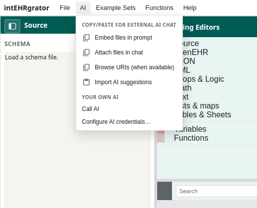
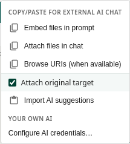

# AI in the web app

The **AI** menu has two sections for the web app, and a third that appears only in the downloaded desktop app. This page is the first two. The desktop section is [Desktop and a local IDE](desktop-and-local-ai.md).

Back to the [tutorial index](../TUTORIAL.md).

*Copy-and-paste actions sit above **Configure AI credentials…**. The chat itself is the **AI chat** panel under Target & Previews.*

## Copy for an external chat

Use this when you paste a prompt into ChatGPT, Claude, Cursor, or another chat you already pay for.

Under **copy/paste for external AI chat**, pick how context is packed. Each choice copies a prompt and remembers that mode for next time:

- **Embed files in prompt** — schema, template, and examples are inside the markdown.
- **Attach files in chat** — the prompt tells you which files to attach yourself.
- **Browse URIs (when available)** — the prompt points at URLs instead of embedding bytes.

Every prompt describes the target as a compact **slot tree** (each value slot with its type, allowed values and fixed units) and names the template, archetypes or schemas once under **Models**. The raw target file (an OPT can be 100,000 tokens) is left out unless you tick **Attach original target**; the choice is saved with the project. The same checkbox is in the AI chat panel's copy menu.

Without credentials the **AI chat** panel offers the same flow: type your request, **Copy prompt**, paste it into your chat, then **Import AI answer…**.

**Import AI suggestions** (menu) and **Import AI answer…** (chat) open the same dialog. It accepts raw JSON or an `intehrgrator-suggestions` fence and shows what will be applied. Validation errors stay in the dialog so you can copy them back to the chat. The format is [AI_SUGGESTION_FORMAT.md](../AI_SUGGESTION_FORMAT.md). This dialog is only for pasted answers.

## Your own AI

Use this when intEHRgrator should call the model itself.

1. **Configure AI credentials…** — pick a provider, endpoint, API key, and model. Credentials stay in this browser. They are never stored in the Project Bundle. There is nothing else to choose: the chat always uses the mapping tools.

   

2. Type in the **AI chat** panel and press **Send**. The answer streams in, with the model's reasoning when the provider sends it. The model maps with the same tools as MCP (`list_slots`, `map_slot`, `import_suggestions`, `get_example`, `run_test`, …) right on the canvas, and each applied mapping shows as a short **✓ Mapped …** line. While it runs, **Send** becomes **Stop** (or press Esc); what was mapped before Stop stays.

   

3. When the turn ends, the whole turn is one **Undo** step (↶ or Ctrl+Z); the status line says it was a change by the AI chat. The **History** button (clock, next to Undo / Redo) lists every change with who made it; **Revert** on the AI turn takes back only that turn and keeps what you changed later. Blocks the AI wrote carry a small purple **AI** badge until you change them. You can keep chatting; later messages send only your new text.

   

If a provider does not support function tools, the chat asks once for suggestions JSON and applies it directly, also as one Undo step.

On GitHub Pages the browser often cannot reach a cloud API (CORS). The desktop app forwards AI chat requests through its own server, so Gemini, OpenAI, Anthropic, Hugging Face, and OpenCode Zen work there. Key pages: [AI chat credentials](../AI_CREDENTIALS.md).

| Provider | Create credentials |
|----------|-------------------|
| Google Gemini | [AI Studio API keys](https://aistudio.google.com/app/apikey) · [OpenAI-compat docs](https://ai.google.dev/gemini-api/docs/openai) |
| OpenAI | [API keys](https://platform.openai.com/api-keys) · [Chat completions](https://platform.openai.com/docs/api-reference/chat) |
| Anthropic Claude | [Console keys](https://console.anthropic.com/settings/keys) · [OpenAI SDK compat](https://platform.claude.com/docs/en/api/openai-sdk) |
| Ollama local | [OpenAI compatibility](https://docs.ollama.com/openai) (dummy key `ollama`) |
| Ollama Cloud | [API keys](https://ollama.com/settings/keys) · [Cloud](https://docs.ollama.com/cloud) |
| LM Studio local | [OpenAI compat](https://lmstudio.ai/docs/developer/openai-compat) · [Auth tokens](https://lmstudio.ai/docs/developer/core/authentication) |
| LM Studio cloud / remote | [LM Link](https://lmstudio.ai/docs/lmlink/basics) · [Bionic models](https://lmstudio.ai/docs/bionic/models) |
| Hugging Face | [Access tokens](https://huggingface.co/settings/tokens) · [Inference Providers](https://huggingface.co/docs/inference-providers/en/index) |
| OpenCode Zen | [Auth / API key](https://opencode.ai/auth) · [Zen](https://opencode.ai/docs/zen/) |

Refreshing a target or source opens a report with **Copy merge prompt** and **Open in AI chat**. Blocks you detached stay on the canvas.

**Run Test** after any AI pass. See [Tests and export](tests-and-export.md).
